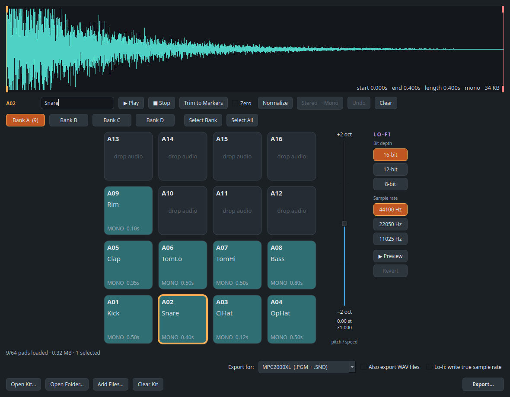
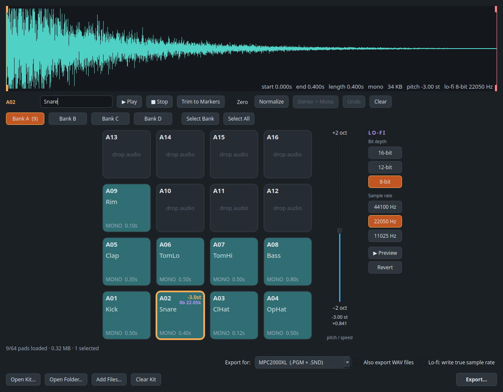
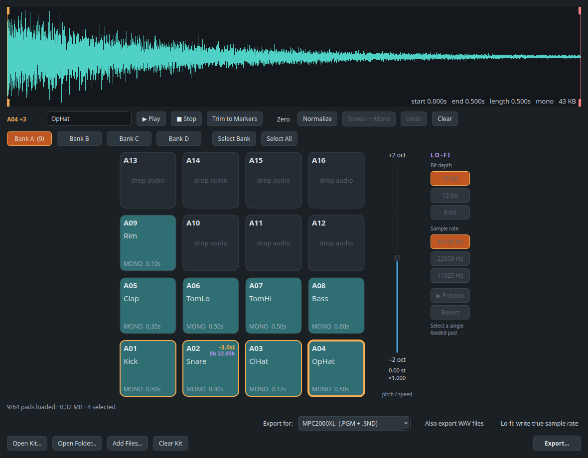
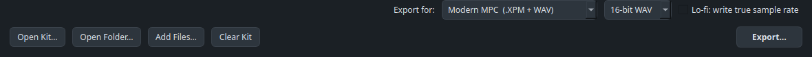

# MPC Kit Builder: Quickstart

> [!CAUTION]
> **No warranty.** This software is provided **"as is", without warranty of any kind**. Use it at your own risk and back up your samples and SD card first. The export formats have not been verified on hardware. See the [disclaimer](../README.md#disclaimer).

This guide takes you from nothing to a kit on your MPC in about five minutes.

## 1. Install and start

You need a Mac with Python 3.10 or newer. Download the latest source zip from the [Releases page](https://github.com/keebz/mpc-kit-builder/releases/latest), unzip it, and double-click **`run.command`** (first time: right-click > Open). Full details are in the [README](../README.md#install).

## 2. Load your sounds

Drag audio files onto the pads. Several files fill pads in order. Or click **Open Folder...** to fill the empty pads across banks A-D (up to 64). Everything is converted to 16-bit / 44.1 kHz on import.

- Click a pad to select it and hear it. **Space** plays it again.
- The waveform at the top shows the selected pad. Drag the orange **START** and **END** handles, then press **Trim to Markers**.
- **Control-click** a pad to rename it. **Right-click** deletes it (you are asked to confirm).
- **Drag** a pad onto another to move it. Dropping on a full pad swaps the two.
- Pad A01 is bottom-left, like the hardware.

## 3. Shape the sounds

**Tick Zero** to snap the markers to the nearest zero crossing so a cut does not click. **Normalize** brings the peak to 0 dBFS. **Stereo -> Mono** halves the file size. **Undo** (Cmd-Z) reverts the last destructive edit on a pad.

The slider on the right is a tape-style **pitch / speed** control (plus or minus 2 octaves). Double-click it to reset. The **Lo-fi** panel reduces bit depth and sample rate. Both are non-destructive: the original stays in memory and the effect is applied when you export. Press **Preview** to hear lo-fi, **Revert** to undo it.

## 4. Edit several pads at once

Shift-click (or Cmd-click) to select pads in any order and across banks. **Select Bank** and **Select All** (Cmd-A) grab every loaded pad. Trim, Normalize, Stereo -> Mono, Undo, Clear and the pitch slider then act on every selected pad.

## 5. Export

Choose your machine in **Export for:** and click **Export...**

| Target | What you get | On the MPC |
|---|---|---|
| **MPC2000XL** | `NAME.PGM` + a `.SND` per sample | Copy to the card and load the program. Tick *Also export WAV files* for WAV copies too. |
| **Modern MPC** (Live, X, One, Key, ...) | a folder with `Kit.xpm` + WAVs | Keep the `.xpm` and WAVs together. If the program does not load, import the WAVs from the Sample Pool and assign them by hand. |
| **MPC Sample** | a folder with `Kit.mpcsample` + WAVs named `A01 - Name.wav` | Copy the whole folder to the microSD card, then Load > External > Load Kit. |

Sample names longer than 5 characters are shortened to the first 4 characters plus the pad label (`SnarA01`). Rename a sample first if you want control over the result.

By default lo-fi pads are written as normal 44.1 kHz files. Tick **Lo-fi: write true sample rate** to keep the reduced rate and get smaller files (the MPC2000XL supports 44100 and 22050 Hz natively, so test 11025 first).

## 6. Edit an existing kit

Click **Open Kit...** and pick a `.PGM`, `.xpm` or `.mpcsample`. Samples are loaded from the same folder as the kit file. A `.PGM` keeps its pad settings and writes them back on export. See the [README](../README.md#use) for what each format preserves.

## Tips

- Test a new kit in the free VMPC2000XL emulator, or on a spare card, before trusting it.
- Keep your originals. Trim, Normalize and Stereo -> Mono are destructive (one level of undo per pad).
- Screenshots in this guide use synthesized test sounds.
